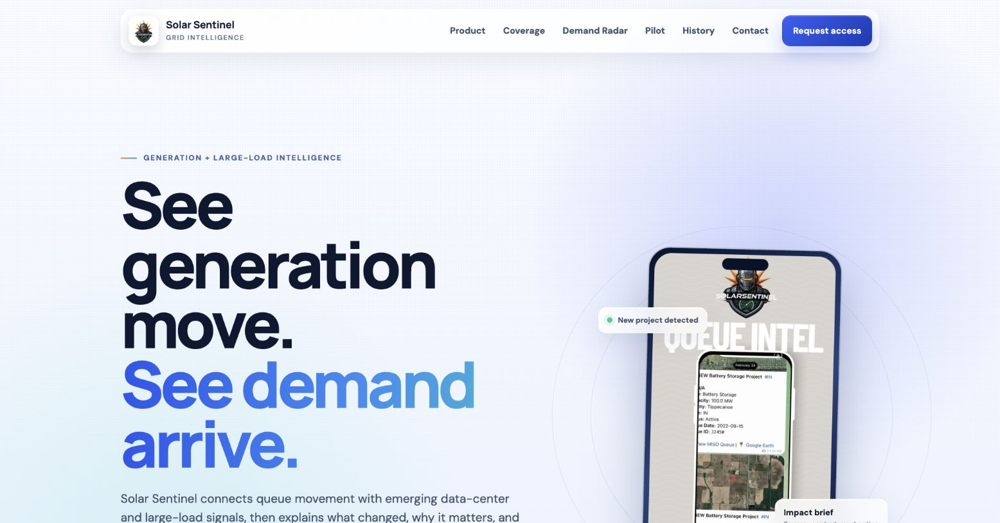
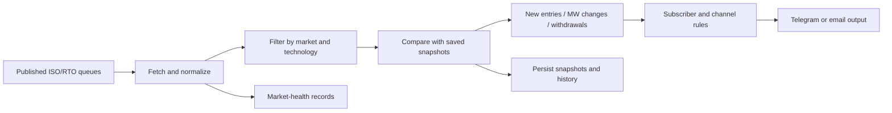

# Solar Sentinel

**Interconnection queue intelligence for solar, storage, and infrastructure teams.**

A Python monitoring pipeline that collects published ISO/RTO queue records, detects material changes, and prepares market-specific alerts. The business goal is to reduce repeated spreadsheet research and help teams decide which projects deserve a closer look.

[Product preview](https://sentinel-alerts.vercel.app/) · [Pipeline](solar_sentinel_enhanced.py) · [Reliability tests](tests/test_reliability_and_features.py) · [LinkedIn](https://www.linkedin.com/in/jaredtheaman/)



*Unedited screenshot of the public product preview, October 27, 2026. The interface illustrates the product; it is not evidence of active customer monitoring.*

## Current state

- The public site is a **design-partner preview**.
- The daily scanner's GitHub Actions workflow is **manual-only** and runs in dry-run mode. Automatic daily scanning is paused; customer alert delivery is not implied.
- The separate weekly digest workflow defines a Monday `13:00 UTC` schedule. Configuration in source does not establish successful email delivery.
- Queue snapshots and scan-health records are retained in `data/`. Check timestamps before using them as current market evidence.
- The public site and this repository can advance independently. The screenshot documents the deployed interface; source links below document this checkout's implementation.

## Engineering walkthrough



| Component | Implementation | Why it matters |
| --- | --- | --- |
| Queue collection | [solar_sentinel_enhanced.py](solar_sentinel_enhanced.py) | Normalizes inconsistent source records across six ISO/RTO markets |
| Filters and event history | [sentinel_features.py](sentinel_features.py) | Converts changes into configurable, inspectable events |
| Scan-health policy | [scripts/enforce_scan_health.py](scripts/enforce_scan_health.py) | Separates known source degradation from actionable failures |
| Weekly briefing | [email_digest.py](email_digest.py) | Summarizes changes against weekly baselines |
| Operator tools | [subscriber_manager.py](subscriber_manager.py) | Manages local subscriber configuration and routing |
| Web/report prototype | [web/](web/) | Next.js UI and Risk Radar report-generation source |

## Coverage in source

| ISO/RTO | Configured states |
| --- | --- |
| MISO | Illinois, Indiana |
| ERCOT | Texas |
| CAISO | California |
| NYISO | New York |
| PJM | New Jersey, Ohio |
| ISO-NE | Massachusetts |

Source availability varies. A monitored market is not a guarantee that its upstream feed is healthy on every run. Florida and subscriber API access remain roadmap items in the historical operator notes.

## Reliability decisions

- Compare source records with persisted snapshots so changes can be inspected across runs.
- Preserve market-health status separately from business events.
- Keep a dry-run path for validating payloads without delivering notifications.
- Test schema changes, state normalization, subscriber filtering, and scan-health policy.
- Treat satellite/geocoding context as context, not proof of a project's exact location or development status.

The suite includes checks for source schema changes, NYISO response handling, filtering, and stale health files. See [tests/](tests/) for actual cases; these tests do not establish current availability of every upstream service.

## Run locally

Python 3.12+ is the supported workflow baseline.

```bash
git clone https://github.com/jaredT27/solarsentinel.git
cd solarsentinel
python3 -m venv .venv
source .venv/bin/activate
python -m pip install -r requirements.txt
python -m pytest -q
```

For a source-fetching preview, copy `.env.example` to `.env`, configure local credentials and `config.yaml`, then run:

```bash
python solar_sentinel_enhanced.py --dry-run
python email_digest.py --dry-run
```

The scanner dry run still fetches source data and may update local snapshots/history. Use a disposable checkout to preserve an existing baseline. Notification delivery requires separately configured credentials and channels.

### Workflows

- [Manual scan](.github/workflows/cron.yml): tests, dry-run scan, persisted snapshots, and market-health gate.
- [Weekly digest](.github/workflows/email-digest.yml): baseline comparison and configured email output.

See [SECURITY.md](SECURITY.md) for credential handling. The [historical operator reference](docs/legacy-operator-guide.md) preserves previous setup and commercial details; its pricing and delivery promises are not the current offer.

## What this project demonstrates

Domain-specific collection, normalization, change detection, configurable routing, operational health checks, and a usable research output. Customer counts, time savings, and revenue outcomes are not claimed here without supporting measurements.

Built by **Jared Theaman**. [Contact](mailto:jared@clauffice.com) · [LinkedIn](https://www.linkedin.com/in/jaredtheaman/)
